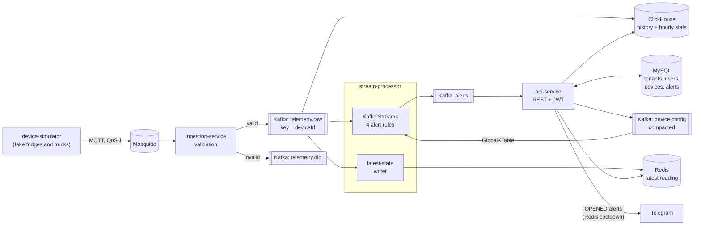
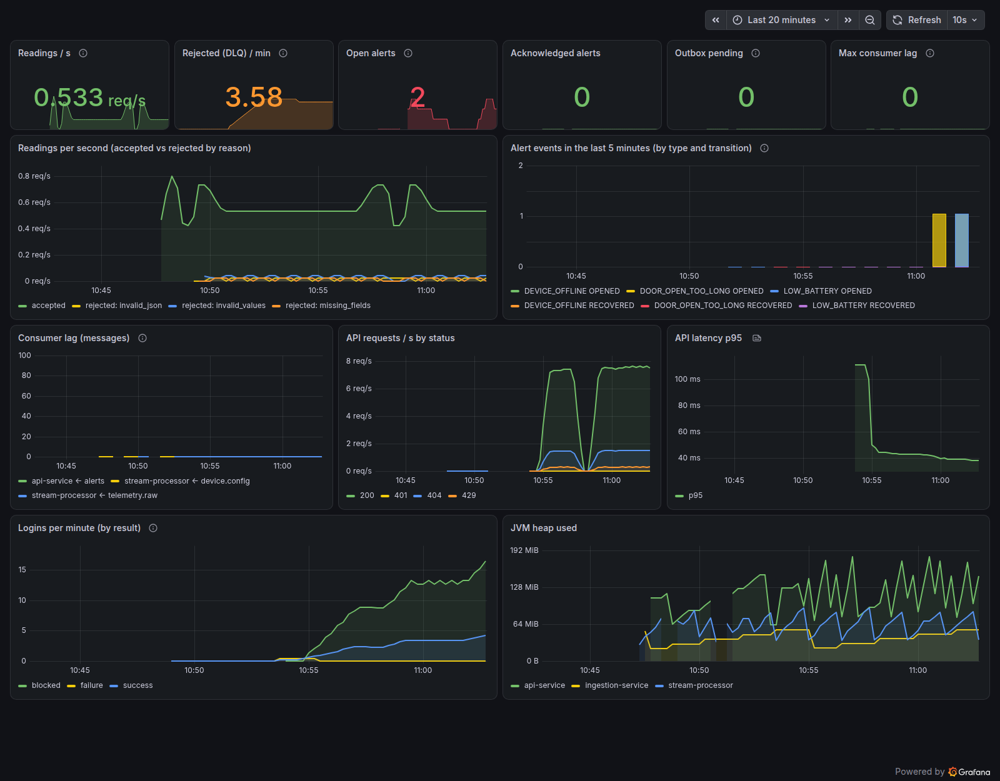

# coldchain-monitor

[](https://github.com/ahmedfathi-code/coldchain-monitor/actions/workflows/ci.yml)

Real-time cold-chain monitoring for pharmacies and medicine transport trucks: sensors stream
temperature, humidity, door state and battery level; the platform detects dangerous
conditions, alerts people on Telegram and produces compliance reports.

**Java 21 · Spring Boot 4.1 · MQTT (Mosquitto) · Kafka (KRaft) · Kafka Streams · ClickHouse ·
Redis · MySQL 8 + Flyway · Spring Security + JWT · springdoc-openapi · Micrometer · Prometheus ·
Grafana · JUnit 5 · Testcontainers**

## Problem statement

Vaccines, insulin and many other medicines must be stored between **2 and 8 °C**. A fridge
whose power fails at night, a door left open, a delivery truck whose cooling unit breaks
down: a few hours out of range can make medicines ineffective, and nobody notices until it
is too late. Regulators also expect pharmacies to **prove** that medicines were stored
correctly.

coldchain-monitor solves both problems:

- **Detect, in real time,** a temperature out of range for too long, a door open for too
  long, a device that went silent and a battery about to die, and notify people once per
  incident (not every 5 seconds).
- **Prove compliance** afterwards: full history, hourly statistics and a compliance report
  per device and period (minutes out of range, number of excursions, compliance %).
- **Serve several customers** (pharmacies) from one platform, each seeing only its own data.

## Architecture



| Module              | Responsibility                                                              |
|---------------------|-----------------------------------------------------------------------------|
| `common`            | Shared event contracts (telemetry, alerts, device config), topic names, JSON serdes |
| `device-simulator`  | Fake devices publishing telemetry to MQTT, with failure scenarios           |
| `ingestion-service` | MQTT → Kafka: validation, dead letter queue, at-least-once delivery         |
| `stream-processor`  | Kafka Streams alert rules (state stores, punctuator) + latest reading to Redis |
| `api-service`       | REST API, JWT security, tenant isolation, alert lifecycle, reports, Telegram |
| `infra/`            | Docker Compose, Mosquitto config, Kafka topics, ClickHouse schema, smoke test |

**How a reading travels:** a device publishes JSON to
`coldchain/{tenantId}/devices/{deviceId}/telemetry`. The ingestion service validates it and
writes it to `telemetry.raw` (or to `telemetry.dlq` with the reason). From there, ClickHouse
consumes it by itself (Kafka engine table + materialized views), the stream processor keeps
the latest reading in Redis and evaluates the alert rules on device event time, and alerts
flow to the api-service, which stores them, resolves them when the device recovers and
notifies people.

**Alert rules** (each emits `OPENED` once when the condition starts and `RECOVERED` once when
it ends):

| Rule                 | Condition                                                          | Severity |
|----------------------|--------------------------------------------------------------------|----------|
| `TEMP_EXCURSION`     | temperature outside [minTemp, maxTemp] for ≥ excursionMinutes (15) | CRITICAL |
| `DOOR_OPEN_TOO_LONG` | door open for ≥ doorOpenMaxMinutes (5)                             | WARNING  |
| `DEVICE_OFFLINE`     | no reading for 5 minutes (wall-clock punctuator)                   | CRITICAL |
| `LOW_BATTERY`        | battery below 15 %                                                 | WARNING  |

Thresholds are per device (set through the API, published to `device.config`); the values
in brackets are the defaults.

## Quick start

Prerequisites: **Docker** with Docker Compose v2. (For building and testing outside Docker:
JDK 21; Maven is not needed, use the wrapper `./mvnw` or `mvnw.cmd` on Windows.)

```bash
git clone https://github.com/ahmedfathi-code/coldchain-monitor.git
cd coldchain-monitor
docker compose -f infra/docker-compose.yml up -d --build --wait
```

That one command builds the four services, starts the infrastructure with healthchecks in
the right order, creates the Kafka topics and starts the simulator. The first build downloads
Maven and the dependencies inside Docker and takes a few minutes. Then:

```bash
bash infra/smoke-test.sh     # checks the whole pipeline through the API (needs curl)
```

| Service           | Address                                        | Notes                                     |
|-------------------|------------------------------------------------|-------------------------------------------|
| **API + Swagger** | <http://localhost:8080/swagger-ui.html>        | demo users below                          |
| **Grafana**       | <http://localhost:3000>                        | "Coldchain overview" dashboard, no login needed to view (admin: `admin` / `grafana_dev_password`) |
| Prometheus        | <http://localhost:9090>                        | scrape targets under Status → Target health |
| Kafka UI          | <http://localhost:8089>                        | browse topics and messages                |
| ClickHouse        | `http://localhost:8123`                        | user `coldchain`                          |
| ingestion-service | `http://localhost:8081/actuator/health`        |                                           |
| Mosquitto         | `localhost:1883`                               | accounts `simulator` / `ingestion`        |
| Kafka             | `localhost:29092`                              | KRaft single node                         |
| Redis             | `localhost:6379`                               | password required                         |
| MySQL             | `localhost:3306`                               | database `coldchain`                      |

All ports are bound to `127.0.0.1`. Credentials default to development-only values in
`infra/docker-compose.yml`; to change them, copy `.env.example` to `infra/.env` and edit it.

Stop everything and delete all data: `docker compose -f infra/docker-compose.yml down -v`

## Demo walkthrough

About 10 minutes, showing detection, notification, the alert lifecycle, the compliance
report, the dead letter queue and tenant isolation.

**1. Start with two incidents.** Every scenario starts after one minute of normal readings.

```bash
SIMULATOR_SCENARIOS="nile-fridge-01=POWER_OUTAGE,delta-fridge-01=INVALID_PAYLOAD" \
  docker compose -f infra/docker-compose.yml up -d --build --wait
```

(PowerShell: `$env:SIMULATOR_SCENARIOS="nile-fridge-01=POWER_OUTAGE,delta-fridge-01=INVALID_PAYLOAD"`
first, then the same `docker compose` command.)

**2. Watch the data (minute 0-1).** In Kafka UI (<http://localhost:8089>) open
`telemetry.raw`: one message per device every 5 seconds, keyed by device. In Swagger, log in
as `operator@nile-pharmacy.local` (see [Demo users](#demo-users)), click **Authorize**, and
call `GET /api/devices/nile-fridge-01/latest` a few times: from minute 1 the power is out and
the temperature climbs about 1 °C per minute.

**3. The dead letter queue (from minute 0).** In Kafka UI open `telemetry.dlq`: every third
message of `delta-fridge-01` is there, untouched, with an `error-reason` header (not JSON,
missing field, 999 °C, wrong tenant). Its valid readings still reach ClickHouse, and the
broken ones never trigger an alert.

**4. The alert (about minute 6).** After 2 minutes above 8 °C (the demo devices have short
thresholds) the stream processor emits `TEMP_EXCURSION OPENED`. The api-service stores it and
sends **one** Telegram message (or logs it: `docker compose -f infra/docker-compose.yml logs
api-service`). `GET /api/alerts` shows it with status `OPEN`. Acknowledge it with
`PATCH /api/alerts/{id}/acknowledge`: status `ACKNOWLEDGED`, `acknowledgedBy` = you.

**5. Recovery (about minute 7.5).** Power comes back at minute 7, the fridge cools down, the
stream processor emits `RECOVERED` and the api-service resolves the alert automatically:
`GET /api/alerts` shows `RESOLVED`, `resolvedBy: "system"`.

**6. The compliance report.**
`GET /api/reports/compliance?deviceId=nile-fridge-01&from=<start time>&to=<now>` (ISO-8601,
e.g. `2026-09-28T18:19:00Z`): about 4 minutes out of range, 1 excursion, the maximum
temperature, and the compliance percentage. `GET /api/devices/nile-fridge-01/stats/hourly`
shows the same peak in the hourly statistics.

**7. Tenant isolation.** Log in as `admin@delta-pharmacy.local` and call
`GET /api/devices/nile-fridge-01` or `GET /api/alerts/{the nile alert id}`: **404**, the
Delta pharmacy cannot even see that these exist.

### All scenarios

| Scenario          | What happens                                              | Alerts (with the demo thresholds)                  |
|-------------------|-----------------------------------------------------------|----------------------------------------------------|
| `NORMAL`          | 5 °C ± noise, door closed, battery 90-100 %               | none                                               |
| `POWER_OUTAGE`    | +1 °C/min for 6 min, then the fridge cools down again     | TEMP_EXCURSION OPENED ~6 min, RECOVERED ~7.5 min   |
| `DOOR_LEFT_OPEN`  | door open for 3 minutes                                   | DOOR_OPEN_TOO_LONG OPENED ~2 min, RECOVERED ~4 min |
| `DEVICE_OFFLINE`  | no readings for 7 minutes                                 | DEVICE_OFFLINE OPENED ~6 min, RECOVERED ~8 min     |
| `LOW_BATTERY`     | battery 20 % draining 2 %/min, replaced after 6 minutes   | LOW_BATTERY OPENED ~3 min, RECOVERED ~6 min        |
| `INVALID_PAYLOAD` | every third message is broken                             | none: broken messages go to `telemetry.dlq`        |

Restarting the simulator restarts the scenarios:
`SIMULATOR_SCENARIOS="delta-fridge-02=LOW_BATTERY" docker compose -f infra/docker-compose.yml up -d device-simulator`

The demo devices are seeded with short thresholds (excursion 2 min, door 1 min) so the
scenarios finish in minutes; devices without a config use the defaults (2-8 °C, 15 min, 5 min).

**Telegram:** create a bot with [@BotFather](https://t.me/BotFather), send it a message, get
your chat id from `https://api.telegram.org/bot<token>/getUpdates`, then set
`TELEGRAM_BOT_TOKEN` and `TELEGRAM_CHAT_ID` in `infra/.env` and restart the api-service.
At most one message per device and alert type every 30 minutes (`NOTIFICATION_COOLDOWN`).

### Looking under the hood

```bash
# Full history in ClickHouse (run it twice: the count keeps growing)
curl -u coldchain:clickhouse_dev_password http://localhost:8123 \
  --data-binary "SELECT device_id, count(), max(ts) FROM coldchain.telemetry GROUP BY device_id"

# Latest reading of a device in Redis
docker compose -f infra/docker-compose.yml exec redis \
  redis-cli -a redis_dev_password --no-auth-warning HGETALL device:nile-fridge-01:latest

# Alert events produced by the stream processor
docker compose -f infra/docker-compose.yml exec kafka /opt/kafka/bin/kafka-console-consumer.sh \
  --bootstrap-server localhost:9092 --topic alerts --from-beginning

# Rejected messages with their reason
docker compose -f infra/docker-compose.yml exec kafka /opt/kafka/bin/kafka-console-consumer.sh \
  --bootstrap-server localhost:9092 --topic telemetry.dlq --from-beginning \
  --formatter-property print.headers=true
```

## Observability

Every service exposes metrics at `/actuator/prometheus` (Micrometer). Prometheus scrapes them
every 15 s, and Grafana shows the provisioned **Coldchain overview** dashboard at
<http://localhost:3000>: nothing to set up.



| Metric | From | Meaning |
|--------|------|---------|
| `coldchain_telemetry_accepted_total` | ingestion | valid readings forwarded to `telemetry.raw` |
| `coldchain_telemetry_rejected_total{reason}` | ingestion | messages sent to the DLQ; `reason` is one of `wrong_topic`, `invalid_json`, `missing_fields`, `invalid_values` |
| `coldchain_alerts_emitted_total{type,transition}` | stream-processor | alert events produced (OPENED / RECOVERED) |
| `coldchain_alerts_active{status}` | api-service | alerts still `open` or `acknowledged` (counted in MySQL) |
| `coldchain_outbox_pending` | api-service | `device.config` messages not yet in Kafka |
| `coldchain_auth_logins_total{result}` | api-service | `success`, `failure`, `blocked` (429) |
| `kafka_consumer_fetch_manager_records_lag` | all consumers | messages waiting to be processed, per topic |
| `http_server_requests_seconds_*` | api-service | request rate, status codes and latency (p95 in Grafana) |

The api-service serves its actuator on a separate port (8081) that is only reachable inside the
Docker network, so metrics are never public on the API port 8080.

## API

Swagger UI: <http://localhost:8080/swagger-ui.html>. Call `POST /api/auth/login`, copy the
`accessToken`, click **Authorize** and paste it.

### Demo users

All demo users have the password **`Coldchain#2026`** (demo only; stored as BCrypt hashes).

| Username                        | Role         | Tenant           | Devices                              |
|---------------------------------|--------------|------------------|--------------------------------------|
| `superadmin@coldchain.local`    | SUPER_ADMIN  | -                | manages tenants only                 |
| `admin@nile-pharmacy.local`     | TENANT_ADMIN | `nile-pharmacy`  | `nile-fridge-01`, `nile-truck-01`    |
| `operator@nile-pharmacy.local`  | OPERATOR     | `nile-pharmacy`  |                                      |
| `admin@delta-pharmacy.local`    | TENANT_ADMIN | `delta-pharmacy` | `delta-fridge-01`, `delta-fridge-02` |
| `operator@delta-pharmacy.local` | OPERATOR     | `delta-pharmacy` |                                      |

Roles: SUPER_ADMIN manages tenants; TENANT_ADMIN manages the devices of their tenant;
TENANT_ADMIN and OPERATOR read devices, telemetry and reports and handle alerts. A user only
ever sees their own tenant's data (another tenant's device or alert answers 404).

### Endpoints

| Method | Path                                          | Notes                                                       |
|--------|-----------------------------------------------|-------------------------------------------------------------|
| POST   | `/api/auth/login`                             | returns an access token (JWT, 15 min) and a refresh token (7 days) |
| POST   | `/api/auth/refresh`                           | `{"refreshToken":…}` → new access token + new refresh token (single use) |
| POST   | `/api/auth/logout`                            | `{"refreshToken":…}` → 204, ends that login session         |
| CRUD   | `/api/tenants`, `/api/tenants/{id}`           | SUPER_ADMIN                                                 |
| CRUD   | `/api/devices`, `/api/devices/{id}`           | list filters: `type`, `active`; writes go to Kafka via the outbox |
| GET    | `/api/devices/{id}/latest`                    | latest reading (Redis)                                      |
| GET    | `/api/devices/{id}/telemetry?from=&to=`       | readings (ClickHouse), default last 24 h                    |
| GET    | `/api/devices/{id}/stats/hourly?from=&to=`    | hourly min / max / avg temperature                          |
| GET    | `/api/alerts`                                 | filters: `status`, `type`, `deviceId`, `from`, `to`         |
| PATCH  | `/api/alerts/{id}/acknowledge`, `/resolve`    | OPEN → ACKNOWLEDGED → RESOLVED                              |
| GET    | `/api/reports/compliance?deviceId=&from=&to=` | minutes out of range, excursions, min/max/avg, compliance % |

**Sessions:** each refresh returns a new refresh token and the old one stops working. Using an
old refresh token again means it was copied, so the whole session is ended (both the attacker
and the real user must log in again). Only a SHA-256 hash of refresh tokens is stored.

**Login rate limiting:** after 5 failed logins for one username from one IP address, or 20
failed logins/refreshes from one IP, requests are refused with **429 Too Many Requests** and a
`Retry-After` header (seconds) until the 15-minute window ends. Successful logins are never
counted, and a successful login clears that username's failures.

Lists are paginated with `page`, `size` (max 100) and `sort` (e.g. `sort=name,desc`).
Errors are RFC 9457 problem details (`application/problem+json`), for example:

```json
{"type":"about:blank","title":"Not Found","status":404,"detail":"Device delta-fridge-01 not found","instance":"/api/devices/delta-fridge-01"}
```

### Examples

```bash
TOKEN=$(curl -s -X POST http://localhost:8080/api/auth/login \
  -H 'Content-Type: application/json' \
  -d '{"username":"admin@nile-pharmacy.local","password":"Coldchain#2026"}' | jq -r .accessToken)
# (the response also has a refreshToken: POST it to /api/auth/refresh when the access token expires)

curl -s http://localhost:8080/api/devices?type=FRIDGE -H "Authorization: Bearer $TOKEN" | jq
curl -s http://localhost:8080/api/devices/nile-fridge-01/latest -H "Authorization: Bearer $TOKEN" | jq
curl -s "http://localhost:8080/api/alerts?status=OPEN" -H "Authorization: Bearer $TOKEN" | jq
curl -s -X PATCH http://localhost:8080/api/alerts/<alertId>/acknowledge -H "Authorization: Bearer $TOKEN" | jq
curl -s "http://localhost:8080/api/reports/compliance?deviceId=nile-fridge-01&from=2026-01-01T00:00:00Z&to=2026-12-31T00:00:00Z" \
  -H "Authorization: Bearer $TOKEN" | jq

# Create a device (its thresholds are published to Kafka immediately)
curl -s -X POST http://localhost:8080/api/devices -H "Authorization: Bearer $TOKEN" \
  -H 'Content-Type: application/json' \
  -d '{"id":"nile-fridge-02","serialNumber":"SN-NF-0002","name":"Second fridge","type":"FRIDGE",
       "location":"Zamalek","minTemp":2,"maxTemp":8,"excursionMinutes":15,"doorOpenMaxMinutes":5,"active":true}' | jq
```

## Testing

```bash
./mvnw verify        # needs Docker for the integration tests (mvnw.cmd verify on Windows)
```

| Kind | What it proves |
|------|----------------|
| Unit tests (surefire) | JSON contracts; topic parsing; telemetry validation; simulator scenarios; every alert rule with Kafka Streams' `TopologyTestDriver` (start, continue, recover, offline via wall-clock time, per-device config, late data); notifications and cooldown logic |
| `IngestionIT` | real Mosquitto (project config, accounts, ACL) + Kafka: valid → `telemetry.raw`, each invalid kind → `telemetry.dlq` with the reason |
| `ApiSecurityIT` | the whole api-service on real MySQL (Flyway), Kafka and Redis: login, 401/403, **tenant A cannot read or change tenant B's devices or alerts**, alert lifecycle, alert events from Kafka stored and auto-resolved |
| `AuthFlowIT` | refresh token rotation, reuse detection ending the session, logout, only hashes stored; login rate limiting (429 + `Retry-After`, per user and per IP, reset on success) |
| `OutboxIT` | device changes reach `device.config` only after commit (rollback → no message), tombstones on delete; while another instance holds the ShedLock lock, this one publishes nothing |
| `TelemetryRepositoryIT` | ClickHouse queries and the compliance calculation against a real ClickHouse built from `infra/clickhouse/init.sql` |
| `LatestStateWriterIT`, `NotificationCooldownIT` | the Redis Lua script ("save only if newer") and the `SET NX EX` cooldown on a real Redis |
| `infra/smoke-test.sh` | a running stack end to end, through the public API; Prometheus scrapes all three services |

GitHub Actions ([ci.yml](.github/workflows/ci.yml)) runs `./mvnw verify` on every push and
pull request, then builds the images, starts the stack with the one-command quick start and
runs the smoke test.

## Design decisions

The full reasoning (context, decision, alternatives, consequences) is in
[docs/decisions.md](docs/decisions.md). In short:

- **At-least-once from device to Kafka:** the ingestion service acknowledges an MQTT message
  only after Kafka stored it (`acks=all`, idempotent producer, persistent MQTT session), so
  nothing is lost when Kafka is down; consumers tolerate the rare duplicate. (ADR-011)
- **Key = deviceId everywhere:** per-device ordering in Kafka, and simple Redis keys. (ADR-009)
- **ClickHouse fed by Kafka directly** (Kafka engine + materialized views), with an
  `AggregatingMergeTree` for hourly statistics: no extra service for the history. (ADR-013)
- **Alert rules as state machines, not windows:** one reusable "condition held for N minutes"
  processor for three rules, a wall-clock punctuator for offline detection, device event time
  with a grace period, exactly-once processing. (ADR-017 to 019) A device set to
  `active=false` raises no alerts (not even "offline"); its readings are still stored. (ADR-034)
- **Latest reading with an atomic Lua script,** so late data never overwrites newer data. (ADR-014)
- **Notifications with a Redis `SET NX EX` cooldown:** one message per incident, safe with
  several instances. (ADR-021)
- **Stateless JWT with Spring's resource server;** **tenant isolation** by passing the
  token's tenant to every query and answering 404 for other tenants' resources. (ADR-022, 023)
- **Short access tokens + rotating refresh tokens** stored as hashes in MySQL, with reuse
  detection; **login rate limiting** on failed attempts with Redis counters. (ADR-031, 032)
- **Transactional outbox for device thresholds:** a device change and its Kafka message are
  written in the same MySQL transaction; a relay publishes committed messages in order, so
  nothing is lost or published for a rolled-back change, and device writes keep working
  while Kafka is down. (ADR-030) With several api-service instances, **ShedLock** (a lock row
  in MySQL) lets only one of them run the relay at a time, so per-device order holds. (ADR-033)
- **Metrics with Micrometer, Prometheus and a provisioned Grafana dashboard;** labels are
  small fixed sets (never free text), and actuator runs on an internal port. (ADR-035)
- **One multi-stage Dockerfile** for all services, built with the Maven wrapper. (ADR-015)
- **No secrets in the repo:** dev-only defaults, `.env` for overrides, generated Mosquitto
  password file. (ADR-006, 007)

## What I would do next

- **Revoke access tokens immediately** (e.g. when a user is disabled) with a short Redis
  deny-list; today a disabled user's access token stays valid for at most 15 minutes.
- **User management endpoints** (invite users, change passwords); today users come from seed data.
- **Deduplication in ClickHouse** (`ReplacingMergeTree` on device + sequence) for the rare
  duplicates of at-least-once delivery, and a TTL for data retention.
- **Scale ingestion horizontally** with MQTT shared subscriptions; per-device MQTT
  credentials or client certificates (TLS) for real devices.
- **Alerting on the metrics** (Prometheus alert rules or Grafana alerts: DLQ spike, consumer
  lag, outbox growing) and **distributed tracing** (OpenTelemetry) across MQTT → Kafka → API.
- **A small web dashboard** for operators instead of Swagger.
